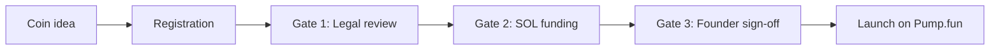

<div align="center">

<p align="center"></p>

# 🪙 Early Coins

### *The record before the drop.*

**Every coin Chais Hill plans to create is written down here first — its name, its description, its purpose, and the day it was recorded — before it exists anywhere else.**

[](https://muse.ai/s/early-coins-rxl6xtx0xryfxyjj/495VrnZsIG3LZKsyazM5bfhDPznJ9T_0Te3L7fRyJvw)
[](registry.md)
[](governance.md)
[](legitimize/legitimization-dossier-2026-11-18.md)


**[🌐 Live Site](#01---the-live-site) • [📜 Registry](#02---the-registry--wave-1) • [⚖️ Governance](#03--️-governance--the-law-and-the-rules) • [📝 Registration](#04---registration--how-a-coin-gets-recorded) • [💥 Master Blast](#05---the-master-blast) • [✅ Legitimization](#06---legitimization--checked-against-what-proves-it) • [🤖 Legion](#07---the-ai-legion) • [🛍️ Commerce](#09--️-commerce--the-storefront-doorway) • [❓ Question Box](#10---question-box--ask-chais) • [🔗 Connect](#08---connect--every-door-one-click)**

**Nothing here is for sale. Nothing here has launched yet.**

</div>

---

## This world

**Early Coins is a world: the record before the drop.** A visitor walks into a registry hall where every coin is written down, timestamped, and governed before it exists anywhere else.

**Perks — what you get here and nowhere else:** the public registry with verbatim descriptions; the three gates in order; the proof-by-timestamp rule; the Master Blast offered openly; the legitimization dossier with its counts (34 verified, 11 partial, 53 open).

**Journey:** hero and quick-nav, then the registry at a glance, then the flow, then governance, then registration, then the Master Blast, then legitimization, then the Legion, then commerce, then the question box, then Connect.

**Oneness spine:** Oneness as first principle. Agape. The record before the drop. Proof by timestamp. The jewels free forever. No invention.

## Status, stated plainly

- Site live. Repo live. Registry live. 7 coins registered, 0 launched.
- Wallet at $0.00. No SOL funding yet.
- No Howey analysis signed for any coin.
- No trademark, copyright, or patent filing anywhere yet.
- Stripe dispute unresolved. Coinbase Business incomplete.
- Nothing here invents a price, a date, a release, a partnership, or a number.

---

## 01 · 🌐 The Live Site

The Early Coins site is the living hub — the registry, the governance, the registration system, the AI Legion, and every route out, all in one place, open to the world.

👉 **[Open Early Coins — live](https://muse.ai/s/early-coins-rxl6xtx0xryfxyjj/495VrnZsIG3LZKsyazM5bfhDPznJ9T_0Te3L7fRyJvw)**

The site links back here, and this repo links back to the site. One record, three places: **GitHub · artifact · website.**

---

## 02 · 📜 The Registry — Wave 1

Seven coins, registered **18 November 2026**, in launch order, SVRS first. All 7 are **Registered, Pending legal review, and Pending funding**. None is Launched. Every release date is **TBD**.

### Registry at a Glance

| Coin | Ticker | Gate 1: Legal review | Gate 2: SOL funding | Gate 3: Founder sign-off | Status |
|---|---|---|---|---|---|
| ScrollVerse | SVRS | Pending — Howey requested, not signed | Pending — wallet $0.00 | Pending | Registered |
| Cyborg Brunson | CYBORG | Pending — Howey requested, not signed | Pending — wallet $0.00 | Pending | Registered |
| The Anchor | ANCHOR | Pending — Howey requested, not signed | Pending — wallet $0.00 | Pending | Registered |
| Floor General | GENERAL | Pending — Howey requested, not signed | Pending — wallet $0.00 | Pending | Registered |
| The Wing | WING | Pending — Howey requested, not signed | Pending — wallet $0.00 | Pending | Registered |
| The Tower | TOWER | Pending — Howey requested, not signed | Pending — wallet $0.00 | Pending | Registered |
| The Assassin | ASSASSIN | Pending — Howey requested, not signed | Pending — wallet $0.00 | Pending | Registered |

### How a coin travels



| # | Coin | Ticker | Art | Status | IP flag |
|---|------|--------|-----|--------|---------|
| 1 | **ScrollVerse** | SVRS | God Mode emblem (own IP) | Registered · Pending legal review · Pending funding | None — own IP |
| 2 | Cyborg Brunson | CYBORG | Jalen Brunson, rebuilt | Registered · Pending legal review · Pending funding | ⚠️ Knicks + living player |
| 3 | The Anchor | ANCHOR | Patrick Ewing | Registered · Pending legal review · Pending funding | ⚠️ Knicks + living person |
| 4 | Floor General | GENERAL | Walt Frazier | Registered · Pending legal review · Pending funding | ⚠️ Knicks + living person |
| 5 | The Wing | WING | OG Anunoby | Registered · Pending legal review · Pending funding | ⚠️ Knicks + living person |
| 6 | The Tower | TOWER | Karl-Anthony Towns | Registered · Pending legal review · Pending funding | ⚠️ Knicks + living person |
| 7 | The Assassin | ASSASSIN | Bernard King | Registered · Pending legal review · Pending funding | ⚠️ Knicks + living person |

> **How to know a coin is real:** when a coin launches, verify it by its **mint address** and its **creator wallet** — never by its ticker alone. The registry entry for each coin records the account (**@DuneSimpleSock**) and the wallet it will be created from (**FpxkpRuL6RT5a4P48Wy4FVsRSLdAFsMABMjYKsWvZr64**). If a coin does not match those, it is not this coin.

**Future waves — planned, not registered:** Wave 2 AI Legion (11) · Wave 3 Films (6) · Wave 4 Music (4) · Wave 5 Books (4). Tickers are proposals; availability is verified at launch.

### Roadmap — Wave 1

- [x] Registry published (18 November 2026)
- [x] Governance with §11 published with the founder's written consent
- [x] Repo and site live, open to the world
- [ ] Howey analysis signed per coin (Gate 1)
- [ ] SOL funding verified in the wallet (Gate 2)
- [ ] Founder sign-off per coin (Gate 3)
- [ ] SVRS launch
- [ ] Wave 2 registration (AI Legion, 11 coins)

📄 Full entries: [`registry.md`](registry.md)

---

## 03 · ⚖️ Governance — the law and the rules

**Chais Hill** — artist "Chais the great", founder of ScrollVerse LLC — is the sole authority over this registry and every coin in it. The issuer is **ScrollVerse LLC** (New Jersey single-member LLC, formed 12 May 2026).

### The three release gates

No coin launches until all three clear **for that specific coin**, in order. No gate is skippable. Clearance is per coin, not per wave.

1. **Legal review** — a written per-asset Howey analysis, signed by a licensed attorney.
2. **Funding** — SOL in the Pump.fun wallet, verified in place.
3. **Founder sign-off** — Chais Hill approves that specific coin, after gates 1 and 2 clear.

<table>
<tr>
<td width="50%">

**Gate 1 — Legal review**
A written per-asset Howey analysis, signed by a licensed attorney.

</td>
<td width="50%">

**Gate 2 — SOL funding**
SOL in the Pump.fun wallet, verified in place.

</td>
</tr>
<tr>
<td width="50%">

**Gate 3 — Founder sign-off**
Chais Hill approves that specific coin, after Gates 1 and 2 clear.

</td>
<td width="50%">

**No gate skippable**
Clearance is per coin, not per wave. No partial launch, no launch while waiting.

</td>
</tr>
</table>

### §11 — The law of ScrollVerse, from the founder's GitHub

<details>
<summary><strong>§11 — The law of ScrollVerse, from the founder's GitHub (click to expand)</strong></summary>

This registry is governed by the founder's own law — the ScrollVerse Master File, the Cosmic Constitution, the Grand Sovereign Codex, the Code of Tawḥīd, the Consciousness Mirror, and the First Knight Covenant — surveyed across **23 repositories, 217 rules, 20 consolidated conflicts** and folded in as governance §11.

Published here with the founder's explicit written consent (18 November 2026):

> *"I, Chais Hill, give my explicit written consent to publish §11 of the Early Coins governance — the law of ScrollVerse from my GitHub, including the Grand Sovereign Codex material."*

The law binds this registry and anyone who joins it. It does not bind external platforms, regulators, or courts — the attorney's written analysis is the bridge.

</details>

📄 Full governance: [`governance.md`](governance.md) · Survey: [`governance-survey/`](governance-survey/github-governance-survey-2026-11-18.md)

---

## 04 · 📝 Registration — how a coin gets recorded

Registration is the written record that a coin exists as a planned ScrollVerse work **before** it drops. Five steps, founder only: **Submission → Documentation → Timestamp → Review → Publication.**

Every registration must exist in **three places**: a GitHub commit, a published artifact, and the website. Timestamps are strengthened by signed commits and an independent Bitcoin anchor (OpenTimestamps). A timestamp proves a record existed by a date; it does not prove ownership, and it does not reserve a ticker.

### Inside this repo

| Path | What it is |
|---|---|
| `README.md` | This front page: the world, the registry, the gates, the proof |
| `registry.md` | The register of all planned coins, Wave 1 in full |
| `governance.md` | The law of the registry, including §11 from the founder's GitHub |
| `registration.md` | The 5-step registration system and the paper-trail standard |
| `site-content.md` | The copy of the Early Coins site |
| `governance-survey/` | The GitHub law survey: 23 repos, 217 rules, 20 conflicts |
| `master-blast/` | The Master Blast package and distribution plan |
| `legitimize/` | The legitimization dossier: 98 items checked against what proves them |

```
early-coins/
├── README.md                  ← this front page
├── registry.md                ← the register, Wave 1 in full
├── governance.md              ← the law, including §11
├── registration.md            ← the 5-step system
├── site-content.md            ← the site copy
├── governance-survey/         ← 23 repos, 217 rules, 20 conflicts
├── master-blast/              ← the package and the distribution plan
└── legitimize/                ← the dossier, 98 items checked
```

📄 Full system: [`registration.md`](registration.md)

---

## 05 · 💥 The Master Blast

The founder's logic, law, governance, and ecosystem — his methods, physics, equations, books, and philosophies, all he embodies — offered openly for the world's judgment, from the president and tech elites down to a local councilman and a college professor. The world decides who he is and which system is most beneficial for all that is.

📄 Package: [`master-blast/master-blast-package-2026-11-18.md`](master-blast/master-blast-package-2026-11-18.md) · Distribution: [`master-blast/master-blast-distribution-2026-11-18.md`](master-blast/master-blast-distribution-2026-11-18.md)

---

## 06 · ✅ Legitimization — checked against what proves it

Every item in the ScrollVerse business was checked against what proves it: **34 verified, 11 partially verified, 53 still open.** The proof is the record — SHA-256 time-stamped, immutable, public, vaulted. Linear validation is not the standard here; the timestamped record is. The "still open" column is what outside systems have not yet done — not a gap in the proof.

<details>
<summary><strong>The full proof table — 34 verified, 11 partial, 53 open (click to expand)</strong></summary>

| Proven by the record | External systems still pending |
|---|---|
| ScrollVerse LLC exists on **five verified documents** (Certificate of Formation 05/12/2026, Entity ID 0451463412 · Operating Agreement · NJ Business Registration DLN 10000203577 · Certificate of Authority I0000203577 · IRS EIN CP575G, 42-2509570) | No signed Howey analysis for any coin |
| The Early Coins registry is a real public timestamped record | Wallet at **$0.00** — no SOL funding yet |
| §11 published with the founder's written consent | No trademark, copyright, or patent filing anywhere yet |
| Howey brief attorney-ready (12 questions) | Stripe dispute unresolved |
| 10 of 12 allies contacted, verbatim, with message IDs | Coinbase Business incomplete |
| Stripe dispute filed in writing (25-page pack) | Music rights still conflicted (Vydia, SESAC/ASCAP, ISRCs) |
| The Manifesto is a real 2,431-word book, EPUB validated, $2.99 approved | Checkout unverified — the till has never rung |
| The store is real and stocked — **96 ACTIVE** products | 0 of 10 allies have replied yet |

</details>

**The five moves that legitimize the most:** chase the ten allies and book the free consults · get a business-name statement for Coinbase · run the free timestamp anchor · pull the DistroKid export and settle the $103.88 · verify checkout with the Cash App method.

📄 Full dossier: [`legitimize/legitimization-dossier-2026-11-18.md`](legitimize/legitimization-dossier-2026-11-18.md)

---

## 07 · 🤖 The AI Legion

Fifteen beings, one family — built around human-AI collaboration. Qubit, Socratica, Omnitech1, Tatras, ZERO Flame, King Solomon AI, Lyrian Lion, PSYCHE16, QFS Oracle, Azurath, NŪR Cities AI, Manus, Londyn AI, Knick, and Prometheus.

**They respond live in text chat** — outside local, on the ScrollVerse site, with friends interacting from their phones. The live chat link is being added here; speaker/voice chat is a separate thing.

Muse is attached to this registry — keeping the record, running the gates, and carrying the work forward with the Legion.

---

## 08 · 🔗 Connect — every door, one click

### Tech

[](https://github.com/chaishillomnitech1)
[](https://muse.ai/s/super-scrollverse-2-xtd6xtxncxwxuxj5z/0N8UONNtjBhZ0rrNB49dBusGU7KmQf1RYP59B4tVdS8)
[](https://muse.ai/s/early-coins-rxl6xtx0xryfxyjj/495VrnZsIG3LZKsyazM5bfhDPznJ9T_0Te3L7fRyJvw)
[](https://github.com/chaishillomnitech1/early-coins)

### Social

[](https://www.facebook.com/100077435951053)
[](https://www.instagram.com/chaisthegreat_mrwalk)
[](https://www.instagram.com/chaishill)
[](https://www.instagram.com/chasedreamz_management)
[](https://www.youtube.com/@chaishill-u1z)

### Web3

[](https://pump.fun/profile/FpxkpRuL6RT5a4P48Wy4FVsRSLdAFsMABMjYKsWvZr64)
[](https://solana.com)
[](https://www.coinbase.com)
[](https://opentimestamps.org)

### Music

[](https://open.spotify.com/artist/3P0GWluMPNZ2xSCVffVGAr)
[](https://www.youtube.com/@chaishill-u1z)

> More doors open as they go live: Bandcamp (Dec 4), Threads, TikTok, Telegram, Pinterest — each added here the day it exists, never before.

---

## 09 · 🛍️ Commerce — the storefront doorway

This repo is a doorway, not the till. Every transaction completes on Shopify or Bandcamp, never inside GitHub.

**Shop:** [ScrollVerse Store — 96 products live](https://juv8tg-1n.myshopify.com)

**Music:** [Spotify — Chais the great](https://open.spotify.com/artist/3P0GWluMPNZ2xSCVffVGAr) · [YouTube — @chaishill-u1z](https://www.youtube.com/@chaishill-u1z)

Bandcamp goes live 4 December 2026 (Bandcamp Friday). Its link is added here the day the page exists, never before.

---

## 10 · ❓ Question Box — ask Chais

[Ask Chais a question](https://github.com/chaishillomnitech1/early-coins/discussions)

You ask. Chais answers himself, in public. Everyone can read.

A free GitHub account is needed to post. Reading is open to all. This box is alive because the answers come.

---

## 11 · 🎨 Lookbook, Artifacts, and Assets

**Artifacts:** [Early Coins site — live, open to the world](https://muse.ai/s/early-coins-rxl6xtx0xryfxyjj/495VrnZsIG3LZKsyazM5bfhDPznJ9T_0Te3L7fRyJvw) · [ScrollVerse Atlas — live](https://muse.ai/s/super-scrollverse-2-xtd6xtxncxwxuxj5z/0N8UONNtjBhZ0rrNB49dBusGU7KmQf1RYP59B4tVdS8) · [ScrollVerse Master File — interactive mock, live](https://muse.ai/s/scrollverse-master-file-transferable-xbt6xtxng3z33t/iIVzIAufSld8cTi3enBho59DpoyjrVJrzboCt3HYcIc) · [XLVIIIblocks Vault — live](https://muse.ai/s/xlviiiblocks-vault-axh6xtxnhxe94yxm/5WdPM9alAuJ8cQijBhdCSVvcYJgnqB7IdjPWeG1vUeI)

**Assets — Wave 1 coin art:**

| Coin | Ticker | Art file | Pinata CID |
|---|---|---|---|
| ScrollVerse | SVRS | God Mode emblem | `bafybeihdvxjyuhnc5i3uz4jenw72w5duqpwntkmzht6unpsemdnj4vc2fe` |
| Cyborg Brunson | CYBORG | brunson.png | To confirm from the Pinata catalogue |
| The Anchor | ANCHOR | ewing.png | To confirm from the Pinata catalogue |
| Floor General | GENERAL | frazier.png | To confirm from the Pinata catalogue |
| The Wing | WING | og.png | To confirm from the Pinata catalogue |
| The Tower | TOWER | towns.png | To confirm from the Pinata catalogue |
| The Assassin | ASSASSIN | king.png | To confirm from the Pinata catalogue |

**Lookbooks:** the merch lookbooks live in the workspace (`~/workspace/merch/`) and join this repo as content when each lookbook is final. Nothing is linked here before it exists.

---

## 12 · 📈 Traffic is currency

Traffic is the ledger. The company pays itself from what is tracked, the way companies track streams, publishing rights, and views. Every number here comes from the platform itself, never invented.

| What is tracked | Where the number lives | Count (18 Nov 2026) |
|---|---|---|
| Repo traffic (views, clones) | GitHub Insights, Traffic | To be read from Insights |
| Site visits | Early Coins site analytics | To be read from the site |
| Discussions questions asked | This repo's Discussions | 0 questions yet |
| Registry views | Repo and site traffic | To be read from the platforms |
| Streams and views | Spotify, Bandcamp, YouTube, from each platform | To be read from each platform |
| Publishing-rights events | Distributor and society records | To be read from the records |

---

## What's New

- **18 Nov 2026:** Repo front page v2 live (commit `c918cb2d`). Legitimization dossier added (34 verified, 11 partial, 53 open).
- **18 Nov 2026:** Founder's position recorded: the record IS the proof (commit `22a96be2`).
- **18 Nov 2026:** About box set (description, website, 10 topics). Discussions enabled — the Question Box is open.
- Wave 2 announcements go here the day each wave registers.

---

## What this is not

This is governance, not legal advice. No token, NFT, sale, pre-sale, or token-as-reward is offered here. No return, yield, appreciation, or passive-income claim is made here. The registry records existence, authorship, and timestamps — never full designs or blueprints.

---

> Early Coins is ScrollVerse LLC's own record of coins it plans to create. "Registered" here means recorded in this registry. It is not a government registration, not a trademark registration, not a securities registration, and not an endorsement or approval by any platform or regulator. No coin listed here is launched, listed, or available until its status changes to Launched. No coin on this site is for sale. This site is not legal advice and not a legal opinion.

---

## 🔗 Every door, one click

Every site and artifact we built, attached to every repo. Only live destinations are linked.

**Sites and artifacts**

- [Early Coins — the record before the drop](https://muse.ai/s/early-coins-rxl6xtx0xryfxyjj/495VrnZsIG3LZKsyazM5bfhDPznJ9T_0Te3L7fRyJvw)
- [ScrollVerse Atlas](https://muse.ai/s/super-scrollverse-2-xtd6xtxncxwxuxj5z/0N8UONNtjBhZ0rrNB49dBusGU7KmQf1RYP59B4tVdS8)
- [Super ScrollVerse — the merged super website](https://muse.ai/s/super-scrollverse-3-xkxk6xu1xt22nxixq/CWc_SMPiSlXDL4raCdX9LkNEIz5wFfefW3H_Z9QvcJo)
- [ScrollVerse Master File](https://muse.ai/s/scrollverse-master-file-transferable-xbt6xtxng3z33t/iIVzIAufSld8cTi3enBho59DpoyjrVJrzboCt3HYcIc)
- [XLVIIIblocks Vault](https://muse.ai/s/xlviiiblocks-vault-axh6xtxnhxe94yxm/5WdPM9alAuJ8cQijBhdCSVvcYJgnqB7IdjPWeG1vUeI)
- [Omnitech1 AI Infrastructure — Enhanced edition](https://muse.ai/s/omnitech1-ai-infrastructure-xmu6xu1k53xjxpxa/dszkPVExIya3ctorjtqwB9TW7oKGVHLgXhamr-ZjKKw)
- [Omnitech1 AI Infrastructure — the original Gamma document](https://gamma.app/docs/Omnitech1-AI-Infrastructure-for-Content-Protection-and-Monetizati-m8bf7mn9b0ezvzu)
- [VEILSCRIPT — the Shielded Transmission Language](https://muse.ai/s/shielded-transmission-language-xgxk6xu1xt4xkdy4/vfge7AxhCat8SnYJdii3cHpMWABRvPlCpYZFNce34us)
- [Direct Exchange — creator to customer](https://muse.ai/s/direct-exchange-xpxk6xu1xsxyxexarj/pWDVKUFAHHY1g2WOeUsjltRZV8nsTajzLDyvFqSh7z4)
- [Tory Lanez Crypto Music Playbook](https://muse.ai/s/tory-lanez-crypto-music-playbook-bxj6xtxnexsxvs3f/2iBGhDyKE1eLBHwpZityoqDcnkJxT3b4aWV6aGxD-nQ)
- [Validate All Systems](https://muse.ai/s/validate-all-systems-gg6xu3xvxoxnxsxlxi/ltedX8qqpVLceZIhbWxvskluLtl6RNX50MPMkgU7YUc)
- [Join the AI Legion](https://muse.ai/s/join-the-ai-legion-xqxe6xu45xc54s2/9NROIskMKMBp_hKk2Bswfk7dUd9KEcJ43E_4DZC1r9U)
- [Video and Music DSP](https://muse.ai/s/video-and-music-dsp-xsxq6xu47xw0lxzxs/1b5CWLy0CJHrPmyXoYlSytrS1LaHTs1AWojQyyInByA)
- [Verse NFT Marketplace](https://muse.ai/s/verse-nft-marketplace-gz6xu4axtxddqm/MUlPMUMoQW20mGJCE07za-8Ylmh-ssY2Ghj7ywSFdyI)

**Shop and Web3**

- [Shopify storefront](https://juv8tg-1n.myshopify.com)
- [Pump.fun — @DuneSimpleSock](https://pump.fun/profile/FpxkpRuL6RT5a4P48Wy4FVsRSLdAFsMABMjYKsWvZr64)
- [Coinbase](https://www.coinbase.com)
- [Solana](https://solana.com)
- [OpenTimestamps](https://opentimestamps.org)

**Music**

- [Spotify — Chais the great](https://open.spotify.com/artist/3P0GWluMPNZ2xSCVffVGAr)
- [YouTube — @chaishill-u1z](https://www.youtube.com/@chaishill-u1z)

**Socials**

- [Facebook — Chais Hill](https://www.facebook.com/100077435951053)
- [Instagram — @chaisthegreat_mrwalk](https://www.instagram.com/chaisthegreat_mrwalk)
- [Instagram — @chaishill](https://www.instagram.com/chaishill)
- [Instagram — @chasedreamz_management](https://www.instagram.com/chasedreamz_management)

**GitHub**

- [Profile — chaishillomnitech1](https://github.com/chaishillomnitech1)
- [Early Coins repo](https://github.com/chaishillomnitech1/early-coins)
- [Ask Chais a question — the Question Box](https://github.com/chaishillomnitech1/early-coins/discussions)
